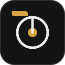
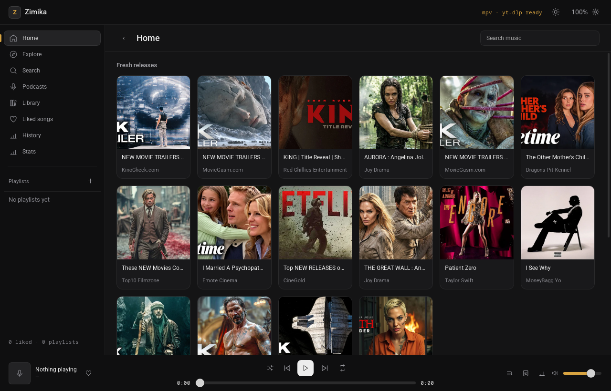

<div align="center">



# Zimika

**A lightweight desktop music player built with MyZig.**

[](https://github.com/agnogad/zimika/releases)
[](https://github.com/agnogad/zimika/actions/workflows/release.yml)
[](https://ziglang.org)
[](#build-from-source)
[](LICENSE)

</div>

---

Zimika is a Zig reimplementation of a lightweight YouTube Music desktop player.
It browses and searches music through `yt-dlp`, plays audio with `mpv`, and keeps
the interface in the operating system's webview. No browser page is loaded, so
there are no web-page ads.



## Features

**Find music**
- **Home** and **Explore** with fresh releases and trending searches.
- **Search** for songs, artists, albums and playlists with result filters and
  saved recent searches.
- **Podcasts** browse view.
- Song menu: play next, start a radio, go to the artist, like, follow, save,
  add to a playlist, cache the song, copy the link.

**Listen**
- Play, pause, next, previous, shuffle, repeat, volume and seek.
- Visible, editable queue; a compact player bar and a full player with queue,
  synced lyrics and related-songs panel.
- **Lyrics** from LRCLIB with synced-line highlighting and plain-text mode.
- **Auto radio** appends similar songs when the queue ends.
- Queue, volume, repeat and shuffle are restored on the next start.
- Keyboard shortcuts: `Space`, `←/→`, `↑/↓`, `S`, `R`, `L`, `Q`, `Y`,
  `Ctrl+F`, `Ctrl+,`.

**Library**
- Like songs, follow artists, save albums, create and delete playlists.
- Sort a playlist by title, artist or length and search inside it.
- Local play history and a listening-stats view with plays per day.

**Make it yours**
- Light, dark or system theme; configurable accent, optionally driven by album
  art; zoom from 80% to 200%.
- Equalizer presets and volume levelling through mpv filters.
- Optional Last.fm scrobbling credentials and browser-cookie selection for
  signed-in or age-restricted content.
- Cache recently played songs; the cache size is configurable.

## Prerequisites

Install these helpers and make sure they are on `PATH`:

```sh
# Linux
sudo apt-get install mpv yt-dlp ffmpeg curl

# macOS
brew install mpv yt-dlp ffmpeg curl

# Windows (PowerShell)
winget install mpv.net yt-dlp.yt-dlp Gyan.FFmpeg curl.curl
```

Zimika reports which helpers it found in the top bar. Browsing needs `yt-dlp`,
playback needs `mpv`, lyrics need `curl`.

## Build from source

Requires [Zig 0.17.1](https://ziglang.org/download/). MyZig is a relative
package dependency, so clone the two repositories side by side:

```sh
git clone https://github.com/agnogad/myzig
git clone https://github.com/agnogad/zimika
cd zimika
zig build run
```

On Linux, install GTK 3, WebKitGTK 4.1, cairo and X11 development packages
first:

```sh
sudo apt-get install libgtk-3-dev libwebkit2gtk-4.1-dev libcairo2-dev libx11-dev
```

Cross-compile with the standard target flag:

```sh
zig build -Dtarget=x86_64-windows --prefix zig-out/windows
zig build -Dtarget=aarch64-macos  --prefix zig-out/macos
```

## Install on Linux

One command downloads the latest release, installs the binary into
`~/.local/bin`, and creates a desktop entry and icon:

```sh
curl -fsSL https://raw.githubusercontent.com/agnogad/zimika/main/install.sh | bash
```

Set `ZIMIKA_INSTALL_DIR` to install somewhere else. To remove Zimika later:

```sh
curl -fsSL https://raw.githubusercontent.com/agnogad/zimika/main/install.sh | bash -s -- --uninstall
```

## Downloads

Ready-built binaries are on the
[releases page](https://github.com/agnogad/zimika/releases):

| Asset | Runner |
| --- | --- |
| `zimika-linux-x86_64` | Ubuntu 24.04 |
| `zimika-macos-x86_64` | macOS (Apple Silicon) |
| `zimika-windows-x86_64.exe` | Windows |

## Tests

```sh
zig build test
bash tests/full_test.sh   # needs Xvfb, mpv, yt-dlp, ffmpeg, curl
```

The end-to-end test serves a short MP3 over local HTTP and verifies interface,
settings, tool status, pages, lyric parsing, playback commands, real mpv
playback, progress events, history and keyboard handlers. A successful run
prints `ZIMIKA FULLTEST PASS ...`.

## Project structure

```
build.zig, build.zig.zon   Zig build and the relative MyZig dependency
src/main.zig               IPC services, yt-dlp search, mpv process control
src/index.html             interface shell and SVG icon set
src/styles.css             unslop theme, layout, motion
src/app.js                 pages, player, queue, lyrics, library, settings
tests/full_test.sh         end-to-end feature check
docs/logo.svg              project logo
```

## Scope

This is a focused desktop player. YouTube sign-in, private YouTube Music APIs,
native media-key integration, Discord Rich Presence, system tray mini player,
matugen schemes, self-updating packages and the full localisation catalogue are
not included.

Design credits: unslop by Damir Sokolovsky
([@heydamir](https://x.com/heydamir)), CC BY 4.0. Zimika itself is MIT licensed.
